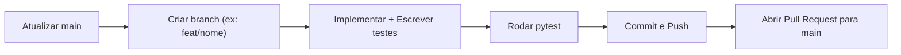

# Guia de Contribuição

Obrigado por contribuir com o **Sistema de Controle de Vendas e Estoque da Lojinha do DACOMP** (`trab_eng_soft`, disciplina **INF01127 - Engenharia de Software**)!

Este guia explica como configurar o ambiente, seguir as convenções do projeto e enviar suas alterações para revisão.

---

## 1. Pré-requisitos e Ambiente Local

Todo o projeto roda em containers Docker (**Python 3.13 + Django** e **PostgreSQL 17**). Você não precisa instalar Python ou PostgreSQL diretamente na sua máquina.

1. Clone o repositório e entre na pasta:
   ```bash
   git clone https://github.com/gbtaffarel/trab_eng_soft.git
   cd trab_eng_soft
   ```
2. Suba os containers:
   ```bash
   docker compose up --build -d
   ```
3. Popule os dados de demonstração (opcional, útil para testar localmente):
   ```bash
   docker compose exec web python manage.py popular_demo --senha <sua-senha>
   ```
4. Verifique se os testes existentes passam antes de começar:
   ```bash
   docker compose exec web pytest
   ```

> [!TIP]
> A pasta do projeto é montada como volume em `/app` dentro do container `web`. Ao salvar qualquer arquivo `.py`, `.html` ou `.css`, o servidor de desenvolvimento do Django recarrega automaticamente.

---

## 2. Fluxo de Trabalho com Git

Nunca trabalhe diretamente na branch `main`. Use o fluxo abaixo para cada nova tarefa, correção ou caso de uso:



1. **Atualize a `main` local:**
   ```bash
   git checkout main
   git pull origin main
   ```
2. **Crie uma branch descritiva:**
   - `feat/<nome-da-funcionalidade>` — novas funcionalidades (ex.: `feat/relatorio-vendas`)
   - `fix/<nome-do-bug>` — correções de bugs (ex.: `fix/troco-pagamento`)
   - `docs/<assunto>` — documentação (ex.: `docs/arquitetura`)
   - `refactor/<escopo>` — refatorações sem mudança de comportamento
3. **Faça commits pequenos e objetivos**, com mensagens claras no imperativo ou presente (ex.: `"Adiciona filtro por período na consulta de vendas"`).
4. **Abra um Pull Request (PR)** para a branch `main` descrevendo o que foi feito, qual caso de uso atende e como testar.

---

## 3. Arquitetura e Convenções do Projeto

O projeto é um **monólito Django em camadas**, organizado por subsistema (Django apps). Conhecer essa divisão evita acoplamento desnecessário e mantém o código consistente:

| Pacote     | Responsabilidade                                              |
|------------|---------------------------------------------------------------|
| `config`   | Configurações (`settings.py`) e roteamento raiz (`urls.py`)   |
| `nucleo`   | Página inicial, templatetags de formatação/paginação e `popular_demo` |
| `contas`   | Autenticação, modelo `Usuario`, perfis (`Diretoria`, `Bolsista`, `Voluntário`) e CLI `criar_conta` |
| `catalogo` | Cadastro, pesquisa e controle de saldo de `Produto`           |
| `vendas`   | `Caixa`, `Venda`, `ItemVenda`, PDV, pagamento e consulta      |

Para mais detalhes e diagramas, consulte [docs/arquitetura.md](docs/arquitetura.md) e [docs/fluxos.md](docs/fluxos.md).

### Regras de Ouro do Código

1. **Separação em camadas dentro de cada app:**
   - `models.py`: entidades, campos, `TextChoices`, constraints e propriedades simples.
   - `servicos.py`: **toda a regra de negócio** e transações (`@transaction.atomic`). Views e forms não devem conter lógica de negócio complexa ou manipulação direta de saldo/estado.
   - `forms.py` / `views.py`: validação de entrada, controle de acesso e orquestração HTTP.
   - `templates/<app>/`: apresentação HTML (usando `templates/base.html` e `static/css/app.css`).
2. **Respeite a direção das dependências:**
   - `vendas` → `catalogo` → `contas`
   - `nucleo` pode importar os demais apps para montar a tela inicial.
   - Evite dependências circulares (ex.: `catalogo` não deve importar `vendas`).
3. **Transações e concorrência:**
   - Operações críticas (como `concluir_venda`, `baixar_saldo`, `abrir_caixa` e `fechar_caixa`) devem usar `@transaction.atomic` e `select_for_update()` quando alteram saldos ou estados concorrentes.
4. **Controle de acesso:**
   - Toda view protegida deve herdar de `contas.mixins.PerfilRequeridoMixin`.
   - Por padrão, `perfis_permitidos = PERFIS_OPERADOR` (os três perfis). Para ações administrativas de catálogo, defina `perfis_permitidos = PERFIS_GESTAO_PRODUTOS` (`Diretoria` e `Bolsista`).
5. **Idioma e nomenclatura:**
   - Código de domínio, modelos, views, URLs, mensagens ao usuário e testes são escritos em **português** (`pt-br`), seguindo o padrão já existente no repositório.
6. **Paginação:**
   - Listagens devem usar `settings.TAMANHO_PAGINA` (atualmente `10` registros por página).

---

## 4. Como Adicionar ou Alterar Funcionalidades

### Novo modelo ou alteração de banco

1. Edite o `models.py` do app correspondente.
2. Gere a migração dentro do container:
   ```bash
   docker compose exec web python manage.py makemigrations
   ```
3. Aplique a migração:
   ```bash
   docker compose exec web python manage.py migrate
   ```
4. Inclua o arquivo gerado em `migrations/` no mesmo commit.

### Testes automatizados

O projeto utiliza **pytest** + **pytest-django** (configurado em `pytest.ini` e com fixtures compartilhadas em `conftest.py`, como `diretoria`, `bolsista`, `voluntario`, `produto` e `servico`).

- Escreva testes para novas regras de negócio em `<app>/tests.py` (ou `test_*.py`).
- Teste tanto o caminho feliz quanto os fluxos de erro/permissão (ex.: usuário sem perfil tentando acessar view restrita, venda sem saldo, fechamento de caixa com diferença sem justificativa).
- Execute a suíte completa antes de abrir o PR:
  ```bash
  docker compose exec web pytest
  ```

---

## 5. Checklist Antes de Abrir um Pull Request

- [ ] O código segue a separação em camadas (`models.py` → `servicos.py` → `forms.py`/`views.py` → `templates/`).
- [ ] Novas views usam `PerfilRequeridoMixin` com os perfis adequados.
- [ ] Alterações em modelos possuem suas respectivas migrações em `migrations/`.
- [ ] Novos testes foram adicionados e toda a suíte (`docker compose exec web pytest`) passa sem erros.
- [ ] Documentação (`README.md` ou `docs/`) foi atualizada caso novas rotas, comandos ou pacotes tenham sido introduzidos.
