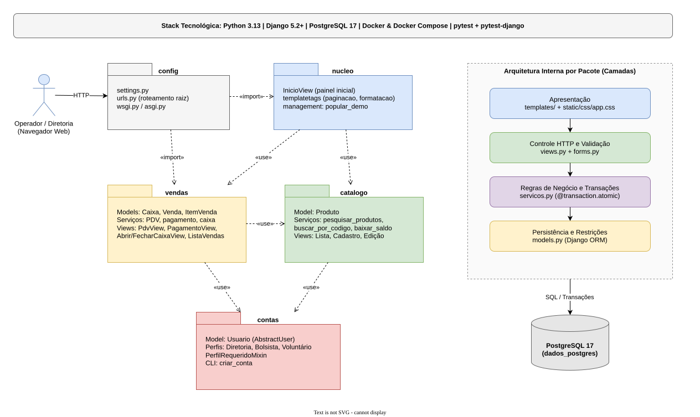

# trab_eng_soft

Repositório para elaboração do trabalho da cadeira INF01127 - Engenharia de Software.

**Sistema de Controle de Vendas e Estoque da Lojinha do DACOMP**: aplicação web em Python + Django.

## Como executar

O sistema roda inteiro no Docker: um container com o banco **PostgreSQL 17** e outro com a aplicação
**Django**. Não é preciso instalar Python nem PostgreSQL na máquina, só o Docker.

### 1. Baixar e instalar o Docker

**Windows 10/11**

1. Baixe o **Docker Desktop for Windows** em https://www.docker.com/products/docker-desktop/.
2. Execute o instalador e mantenha marcada a opção **Use WSL 2 instead of Hyper-V**.
3. Reinicie o computador se o instalador pedir.
4. Se aparecer um aviso sobre o WSL, abra o PowerShell como administrador e rode `wsl --install`;
   depois reinicie.
5. Se o Docker reclamar de virtualização desativada, habilite *Intel VT-x* / *AMD-V* (SVM) na BIOS.

**macOS**

1. Baixe o **Docker Desktop for Mac** em https://www.docker.com/products/docker-desktop/, escolhendo
   *Apple Silicon* (M1/M2/M3/M4) ou *Intel* conforme o seu processador.
2. Abra o `.dmg` e arraste o Docker para a pasta **Aplicativos**.

**Linux (Ubuntu/Debian)**

Instale o Docker Engine com o plugin Compose seguindo https://docs.docker.com/engine/install/ e
adicione seu usuário ao grupo `docker` (`sudo usermod -aG docker $USER`, depois saia e entre na
sessão).

### 2. Abrir o Docker e conferir a instalação

No Windows e no macOS, abra o **Docker Desktop** e espere aparecer *Engine running* no canto
inferior. Ele precisa estar aberto sempre que for usar o sistema. Depois, em um terminal:

```bash
docker --version
docker compose version
```

Os dois comandos devem mostrar uma versão. Se aparecer *cannot connect to the Docker daemon*, o
Docker Desktop não está aberto.

### 3. Subir o sistema

Na pasta do projeto (depois de `git clone https://github.com/gbtaffarel/trab_eng_soft.git`):

```bash
docker compose up --build -d
```

Na primeira vez o Docker baixa as imagens e instala as dependências, o que leva alguns minutos.
As migrações do banco são aplicadas automaticamente. Em seguida, crie as contas e o cardápio de
demonstração:

```bash
docker compose exec web python manage.py popular_demo --senha <escolha-uma-senha>
```

Acesse http://localhost:8000 e entre com `diretoria`, `bolsista` ou `voluntario` e a senha escolhida.

### 4. Contas da equipe

Não há tela de gestão de contas: elas são administradas pela linha de comando.

```bash
# Criar conta (a senha é pedida no terminal); repita --perfil para acumular papéis
docker compose exec web python manage.py criar_conta ana --perfil diretoria --perfil bolsista --nome Ana

# Alterar os perfis de uma conta existente
docker compose exec web python manage.py criar_conta ana --perfil voluntario

# Desativar ou reativar o acesso
docker compose exec web python manage.py criar_conta ana --desativar
docker compose exec web python manage.py criar_conta ana --reativar

# Trocar a senha
docker compose exec web python manage.py changepassword ana
```

Perfis: `diretoria`, `bolsista` e `voluntario`. Diretoria e Bolsista mantêm o cadastro de produtos;
os três perfis operam o PDV e o caixa.

### 5. Uso no dia a dia

| Para…                                   | Comando                                                         |
|-----------------------------------------|-----------------------------------------------------------------|
| Subir o sistema                         | `docker compose up -d`                                          |
| Ver se os containers estão rodando      | `docker compose ps`                                             |
| Acompanhar os logs da aplicação         | `docker compose logs -f web`                                    |
| Rodar os testes                         | `docker compose exec web pytest`                                |
| Criar migrações após mudar um modelo    | `docker compose exec web python manage.py makemigrations`       |
| Criar superusuário para o `/admin`      | `docker compose exec web python manage.py createsuperuser`      |
| Abrir o terminal do PostgreSQL          | `docker compose exec db psql -U lojinha -d lojinha`             |
| Parar o sistema (mantém os dados)       | `docker compose down`                                           |
| Apagar o banco e começar do zero        | `docker compose down -v`                                        |
| Reconstruir após mudar `requirements.txt` | `docker compose up --build -d`                                |

O código da pasta é montado dentro do container: ao salvar um arquivo, o servidor recarrega sozinho,
sem precisar reconstruir. Os dados do banco ficam no volume `sistema-dacomp_dados_postgres` e
continuam lá entre um `down` e outro `up`.

### Problemas comuns

- **Porta 8000 ou 5432 em uso:** feche o programa que usa a porta (outro servidor Django ou um
  PostgreSQL instalado na máquina) e rode `docker compose up -d` de novo.
- **Página não abre logo após subir:** a aplicação espera o banco ficar pronto; aguarde alguns
  segundos e confira com `docker compose logs web`.
- **Credenciais do banco:** o padrão `lojinha`/`lojinha` serve só para desenvolvimento. Para trocar,
  copie `.env.example` para `.env`, ajuste os valores e rode `docker compose down -v` e
  `docker compose up -d` (o banco é recriado com as novas credenciais).

## Arquitetura

Monólito Django em camadas, dividido em pacotes por subsistema. Cada pacote segue
`models.py` (entidades) → `servicos.py` (regras de negócio) → `forms.py`/`views.py` (controle) → `templates/` (apresentação).



| Pacote     | Responsabilidade                                            | Casos de uso (UC01–UC17) |
|------------|-------------------------------------------------------------|--------------------------|
| `contas`   | Autenticação e perfis fixos (Diretoria, Bolsista, Voluntário); contas criadas pela linha de comando | UC01 (UC15 via CLI) |
| `catalogo` | Cadastro e pesquisa de produtos (categoria, unidade, custo, lucro e quantidade em estoque) | UC02, UC13 |
| `vendas`   | PDV, abertura e fechamento de caixa, pagamento, cancelamento e consulta de vendas | UC03, UC04, UC05, UC06, UC07, UC17 |
| `nucleo`   | Página inicial, formatação, paginação e dados de demonstração | —                   |
| `config`   | Configurações e rotas do projeto                              | —                   |

Dependências: `vendas → catalogo → contas`; `nucleo` usa todos. A quantidade em estoque é informada no
cadastro do produto e baixada automaticamente quando uma venda é concluída (`catalogo.servicos.baixar_saldo`).
Venda, pagamento e baixa de estoque são gravados em uma única transação (RNF01): se faltar saldo, nada é
registrado. As listagens usam 10 registros por página.

Simplificação desta etapa: as movimentações de estoque (entradas, ajustes e histórico) não foram
implementadas; o saldo é mantido diretamente no cadastro.

### PDV

O catálogo é principalmente de bar e café (cafés, bebidas, lanches, salgados e doces), organizado
por categoria. Itens preparados na hora, como café coado, podem ser cadastrados sem controle de estoque.

Em **PDV**: abra o caixa e toque nos produtos da grade de atalhos (filtrada por categoria) ou leia o
código de barras (ou digite o código ou parte do nome) e pressione Enter. A comanda fica à direita,
com o total. `F2` volta ao campo de produto e `F4` finaliza a venda. Na
finalização, escolha a forma de pagamento; em dinheiro, o sistema calcula o troco. O fechamento do
caixa confere as vendas por forma de pagamento e exige justificativa quando o valor contado difere do
esperado.

Próximo pacote previsto: `relatorios` (UC50).

## Documentação e Contribuição

- **[Guia de Contribuição](CONTRIBUTING.md)** — fluxo de branches/PRs, convenções de código, migrações e execução de testes.
- **[Arquitetura do Sistema](docs/arquitetura.md)** — diagrama de pacotes, modelo entidade-relacionamento (DER), diagrama de classes de projeto, matriz de perfis e mapa de rotas.
- **[Fluxos de Negócio](docs/fluxos.md)** — máquinas de estado (`Caixa` e `Venda`) e diagramas de sequência (PDV atômico e fechamento de caixa).
- **[Diagramas editáveis](docs/diagramas/)** — fontes `.drawio` e `.drawio.svg` com diagrama embutido.
- **[Casos de Uso](doc/casos_de_uso.md)** — especificação e diagrama de casos de uso.
