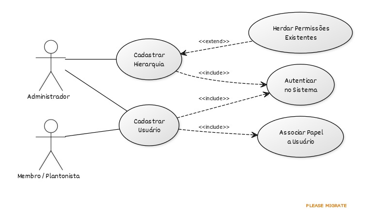

# Casos de Uso

## Diagrama de Casos de Uso

## Especificação dos Casos de Uso

### UC01: Cadastrar Usuário

- **Ator Principal**: Membro do DACOMP (ou Administrador do Sistema).
- **Atores Secundários**: Aluno / Usuário final.
- **Pré-condições**: O operador deve estar autenticado no sistema com perfil de acesso adequado.
- **Pós-condições**: O usuário é persistido na base de dados com perfil/papel atribuído e status ativo.

#### Fluxo Principal

- O operador acessa o menu de gestão de usuários e seleciona a opção "Novo Usuário".
- O sistema exibe o formulário de cadastro solicitando: nome completo, e-mail institucional/pessoal, vínculo (ex: - - Aluno de Graduação, Pós, Docente), número de matrícula e nível de acesso/hierarquia inicial.
- O operador preenche os dados e submete o formulário.
- O sistema valida os campos obrigatórios e a unicidade da matrícula e do e-mail.
- O sistema vincula o usuário à hierarquia/papel selecionado.
- O sistema registra o usuário, gera log de criação e exibe mensagem de confirmação.

#### Fluxos Alternativos e de Exceção

- FA01 - Auto-cadastro de Aluno (se aplicável): O próprio aluno preenche os dados via portal público, ficando com o - papel padrão de "Aluno/Cliente" pendente de ativação ou autoativado via e-mail institucional.
- FE01 - Matrícula ou E-mail já cadastrado: O sistema alerta a duplicidade e impede a gravação, permitindo edição dos dados ou redirecionamento para consulta.
- FE02 - Campos obrigatórios ausentes: O sistema destaca os campos faltantes e bloqueia a submissão.
