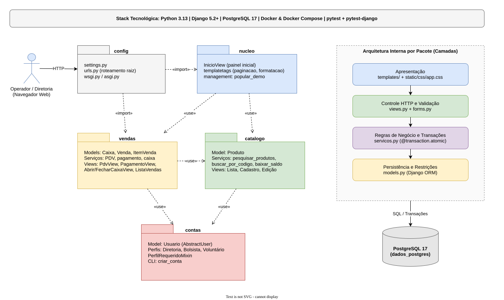
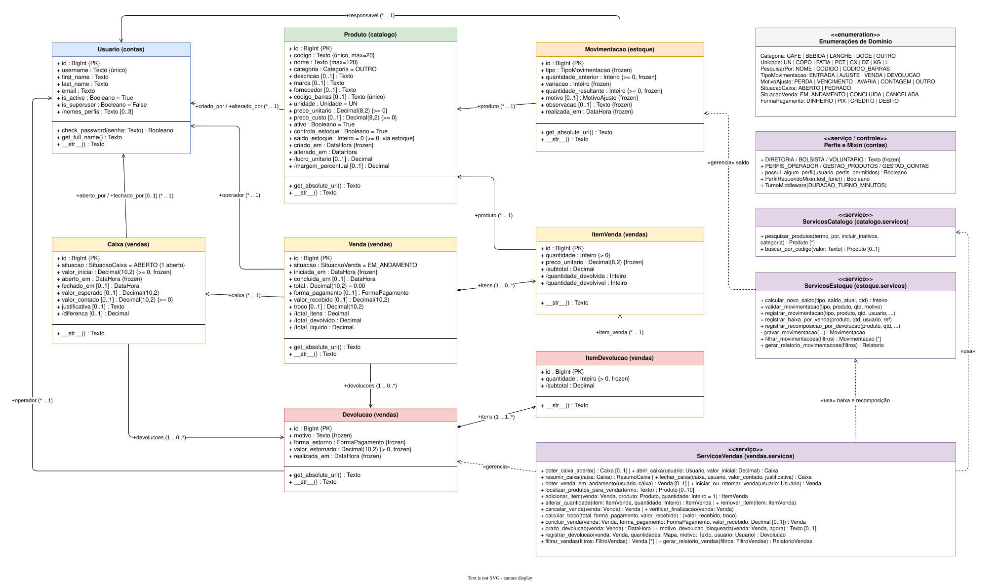

# Arquitetura do Sistema

O **Sistema de Controle de Vendas e Estoque da Lojinha do DACOMP** é um monólito **Django 5.2+** com banco de dados **PostgreSQL 17**, empacotado em containers Docker. A aplicação é organizada em pacotes (Django apps) por subsistema e estruturada internamente em camadas.

---

## 1. Visão Geral em Camadas e Dependências entre Pacotes

Cada subsistema segue o fluxo de responsabilidades `templates/` → `views.py` / `forms.py` → `servicos.py` → `models.py`.

*(Arquivo fonte editável: [diagrama_de_pacotes.drawio](diagramas/diagrama_de_pacotes.drawio))*

### Responsabilidade de cada pacote

| Pacote     | Responsabilidade Principal                                                                                                                                               | Casos de Uso (UC01–UC17)           |
| :--------- | :----------------------------------------------------------------------------------------------------------------------------------------------------------------------- | :--------------------------------- |
| `config`   | Configurações globais (`settings.py`), WSGI/ASGI e roteamento raiz (`urls.py`).                                                                                          | —                                  |
| `contas`   | Autenticação (`LoginView`/`LogoutView`), modelo `Usuario`, perfis via `Group` (`Diretoria`, `Bolsista`, `Voluntário`), `PerfilRequeridoMixin` e comando `criar_conta`.   | UC01 (UC15 via CLI)                |
| `catalogo` | Cadastro, edição, ativação/inativação, pesquisa por nome/código/barras e baixa transacional de saldo (`baixar_saldo`).                                                   | UC02, UC13                         |
| `vendas`   | Abertura e fechamento de `Caixa`, operação do PDV, registro de `Venda`/`ItemVenda`, cálculo de troco, pagamento atômico, cancelamento em andamento e consulta de vendas. | UC03, UC04, UC05, UC06, UC07, UC17 |
| `nucleo`   | Dashboard inicial (`InicioView`), templatetags (`estaticos`, `formatacao`, `paginacao`) e comando `popular_demo`.                                                        | —                                  |

> [!NOTE]
> No modelo de análise (`Relatório Final - Lojinha DAcomp`), também estão previstos os pacotes/casos de uso de controle completo de estoque (`UC08`–`UC12`), relatórios básicos (`UC14`), gestão de contas pela interface web (`UC15`) e devolução/estorno (`UC16`). Na etapa atual do código, a gestão de contas é feita via CLI e as movimentações de estoque foram simplificadas para edição direta do saldo no produto.

---

## 2. Modelo de Dados (DER)

O diagrama abaixo representa as entidades persistidas no PostgreSQL e suas principais restrições de integridade:

- **`apenas_um_caixa_aberto`**: `UniqueConstraint` parcial garantindo que exista no máximo um `Caixa` com `situacao = "aberto"` por vez.
- **`produto_unico_por_venda`**: `UniqueConstraint` em `(venda, produto)` em `ItemVenda` (itens repetidos no PDV incrementam a `quantidade` do mesmo registro).

*(Arquivo fonte editável: [diagrama_er.drawio](diagramas/diagrama_er.drawio))*

---

## 3. Diagrama de Classes de Projeto

Em conformidade com os requisitos da **Etapa 3**, o diagrama abaixo apresenta as classes de domínio e seus serviços com **tipos, restrições, métodos/operações e navegabilidade definida**.

*(Arquivo fonte editável: [diagrama_de_classes.drawio](diagramas/diagrama_de_classes.drawio))*

### Documentação das Principais Operações

| Classe / Módulo     | Operação             | Propósito                                                                            | Parâmetros (Tipos)                                                                 | Valor de Retorno    |
| :------------------ | :------------------- | :----------------------------------------------------------------------------------- | :--------------------------------------------------------------------------------- | :------------------ |
| `Produto`           | `lucro_unitario`     | Calcula o lucro por unidade vendida (`preco_unitario - preco_custo`).                | —                                                                                  | `Decimal \| None`   |
| `Produto`           | `margem_percentual`  | Calcula a margem de lucro percentual sobre o preço de venda.                         | —                                                                                  | `Decimal \| None`   |
| `Caixa`             | `diferenca`          | Calcula a diferença entre `valor_contado` e `valor_esperado`.                        | —                                                                                  | `Decimal \| None`   |
| `Venda`             | `total_itens`        | Soma os subtotais de todos os `ItemVenda` associados.                                | —                                                                                  | `Decimal`           |
| `ItemVenda`         | `subtotal`           | Calcula o valor do item (`preco_unitario * quantidade`).                             | —                                                                                  | `Decimal`           |
| `catalogo.servicos` | `pesquisar_produtos` | Filtra produtos por nome, código interno, código de barras, categoria e status.      | `termo: str`, `por: PesquisarPor`, `incluir_inativos: bool`, `categoria: str`      | `QuerySet[Produto]` |
| `catalogo.servicos` | `baixar_saldo`       | Reduz `saldo_estoque` com `select_for_update()` se `controla_estoque=True`.          | `produto: Produto`, `quantidade: int`                                              | `Produto`           |
| `vendas.servicos`   | `abrir_caixa`        | Abre um novo caixa se não houver outro aberto e `valor_inicial >= 0`.                | `usuario: Usuario`, `valor_inicial: Decimal`                                       | `Caixa`             |
| `vendas.servicos`   | `resumir_caixa`      | Consolida vendas concluídas por forma de pagamento e calcula `valor_esperado`.       | `caixa: Caixa`                                                                     | `dict`              |
| `vendas.servicos`   | `fechar_caixa`       | Fecha o caixa validando ausência de venda em andamento e justificativa de diferença. | `caixa: Caixa`, `usuario: Usuario`, `valor_contado: Decimal`, `justificativa: str` | `Caixa`             |
| `vendas.servicos`   | `concluir_venda`     | Grava pagamento, troco e baixa de estoque atomicamente (`@transaction.atomic`).      | `venda: Venda`, `forma_pagamento: str`, `valor_recebido: Decimal \| None`          | `Venda`             |

---

## 4. Controle de Acesso e Perfis

Os perfis são implementados como `Group` do Django em `contas/perfis.py`, permitindo que um usuário acumule mais de um papel. O acesso às views é protegido por `contas.mixins.PerfilRequeridoMixin`.

| Funcionalidade / View                                                                          | `Diretoria` | `Bolsista` | `Voluntário` |
| :--------------------------------------------------------------------------------------------- | :---------: | :--------: | :----------: |
| Tela inicial (`nucleo:inicio`)                                                                 |     ✅      |     ✅     |      ✅      |
| Consultar e detalhar produtos (`catalogo:lista_produtos`, `detalhe_produto`)                   |     ✅      |     ✅     |      ✅      |
| Cadastrar, editar e ativar/inativar produtos (`PERFIS_GESTAO_PRODUTOS`)                        |     ✅      |     ✅     |      ❌      |
| Abrir e fechar caixa (`vendas:abrir_caixa`, `fechar_caixa`)                                    |     ✅      |     ✅     |      ✅      |
| Operar PDV e concluir/cancelar vendas (`vendas:pdv`, `pagamento`, etc.)                        |     ✅      |     ✅     |      ✅      |
| Consultar e detalhar vendas e caixas (`vendas:lista_vendas`, `detalhe_venda`, `detalhe_caixa`) |     ✅      |     ✅     |      ✅      |
| Gestão de contas (`criar_conta`, `changepassword` via CLI)                                     |      —      |     —      |      —       |

---

## 5. Mapa de Rotas (URLs)

Todas as rotas da aplicação são centralizadas em `config/urls.py`:

| Prefixo      | App                    | Principais Endpoints                                                                                                                               |
| :----------- | :--------------------- | :------------------------------------------------------------------------------------------------------------------------------------------------- |
| `/`          | `nucleo`               | `/` (`inicio`)                                                                                                                                     |
| `/conta/`    | `contas`               | `/conta/entrar/`, `/conta/sair/`                                                                                                                   |
| `/produtos/` | `catalogo`             | `/produtos/`, `/produtos/novo/`, `/produtos/<pk>/`, `/produtos/<pk>/editar/`, `/produtos/<pk>/situacao/`                                           |
| `/vendas/`   | `vendas`               | `/vendas/pdv/`, `/vendas/pdv/<pk>/pagamento/`, `/vendas/caixa/abrir/`, `/vendas/caixa/fechar/`, `/vendas/caixa/<pk>/`, `/vendas/`, `/vendas/<pk>/` |
| `/admin/`    | `django.contrib.admin` | Painel administrativo padrão do Django                                                                                                             |
