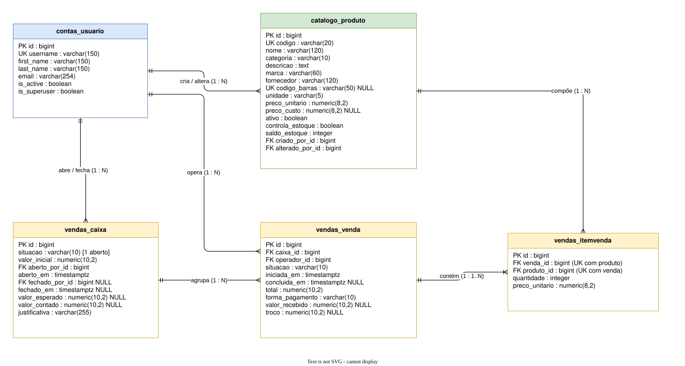

# Arquitetura do Sistema

O **Sistema de Controle de Vendas e Estoque da Lojinha do DACOMP** é um monólito **Django 5.2+** com banco de dados **PostgreSQL 17**, empacotado em containers Docker (**Gunicorn + WhiteNoise** na implantação em rede local, sem dependência de internet graças aos assets em `static/vendor/`). A aplicação é organizada em pacotes (Django apps) por subsistema e estruturada internamente em camadas.

---

## 1. Visão Geral em Camadas e Dependências entre Pacotes

Cada subsistema segue o fluxo de responsabilidades `templates/` → `views.py` / `forms.py` → `servicos.py` → `models.py`.

*(Arquivo fonte editável: [diagrama_de_pacotes.drawio](diagramas/diagrama_de_pacotes.drawio))*

### Responsabilidade de cada pacote

| Pacote     | Responsabilidade Principal                                                                                                                                                                  | Casos de Uso (UC01–UC17)                |
| :--------- | :------------------------------------------------------------------------------------------------------------------------------------------------------------------------------------------ | :-------------------------------------- |
| `config`   | Configurações globais (`settings.py`: `DURACAO_TURNO_MINUTOS`, `PRAZO_DEVOLUCAO_DIAS`, `TAMANHO_PAGINA`), WSGI/ASGI e roteamento raiz (`urls.py`).                                          | —                                       |
| `contas`   | Autenticação (`LoginView`/`LogoutView`), modelo `Usuario`, perfis via `Group` (`Diretoria`, `Bolsista`, `Voluntário`), gestão web de contas, troca/redefinição de senha, sessão por turno (`TurnoMiddleware`), `PerfilRequeridoMixin` e comando `criar_conta`. | UC01, UC15                              |
| `catalogo` | Cadastro, edição, ativação/inativação e pesquisa por nome/código/barras (`pesquisar_produtos`, `buscar_por_codigo`). O campo `saldo_estoque` é somente leitura (`editable=False`).          | UC02, UC08 (saldo), UC13                |
| `estoque`  | Registro imutável de `Movimentacao` (`ENTRADA`, `AJUSTE`, `VENDA`, `DEVOLUCAO`), único ponto que altera `Produto.saldo_estoque`, consulta com filtros e relatório de movimentações.         | UC09, UC10, UC14                        |
| `vendas`   | Abertura e fechamento de `Caixa`, operação do PDV (atalhos por categoria e pagamento integrado na tela), `Venda`/`ItemVenda`, cálculo de troco (`dinheiro`, `PIX`, `crédito`, `débito`), pagamento atômico, cancelamento em andamento, `Devolucao`/`ItemDevolucao` (com estorno e recomposição de estoque), consulta e relatório de vendas. | UC03, UC04, UC05, UC06, UC07, UC14, UC16, UC17 |
| `nucleo`   | Dashboard inicial (`InicioView` com caixa aberto, produtos ativos, últimas movimentações e últimas vendas), templatetags (`estaticos`, `formatacao`, `paginacao`) e comando `popular_demo`. | —                                       |

> [!NOTE]
> A direção das dependências entre os pacotes de domínio é **`vendas → estoque → catalogo → contas`** (com `nucleo` utilizando todos os demais). O módulo `estoque/servicos.py` é o único ponto do sistema autorizado a alterar `Produto.saldo_estoque`, sempre registrando uma `Movimentacao` na mesma transação atômica.

---

## 2. Modelo de Dados (DER)

O diagrama abaixo representa as 8 tabelas persistidas no PostgreSQL e suas principais restrições de integridade:

- **`apenas_um_caixa_aberto`**: `UniqueConstraint` parcial em `vendas_caixa` garantindo no máximo um `Caixa` com `situacao = "aberto"` por vez.
- **`produto_unico_por_venda`**: `UniqueConstraint` em `(venda, produto)` em `vendas_itemvenda` (itens repetidos no PDV incrementam a `quantidade` do mesmo registro).
- **`item_unico_por_devolucao`**: `UniqueConstraint` em `(devolucao, item_venda)` em `vendas_itemdevolucao`.

*(Arquivo fonte editável: [diagrama_er.drawio](diagramas/diagrama_er.drawio))*

---

## 3. Diagrama de Classes de Projeto

O diagrama unificado abaixo apresenta as entidades, enumerações e serviços do sistema com tipos, restrições, propriedades derivadas, operações e navegabilidade:

*(Arquivo fonte editável: [diagrama_de_classes.drawio](diagramas/diagrama_de_classes.drawio))*

Para detalhamento por subsistema e especificação completa de cada operação (parâmetros, tipos de retorno e exceções), consulte também os diagramas UML em cinco páginas e a referência detalhada:

- **Páginas PlantUML:** [Visão Geral](diagramas/classes-1-visao-geral.svg) · [Pacote `vendas`](diagramas/classes-2-vendas.svg) · [Pacotes `catalogo`, `estoque` e `contas`](diagramas/classes-3-catalogo-estoque-contas.svg) · [Serviços de `vendas`](diagramas/classes-4-servicos-vendas.svg) · [Serviços de `estoque`, `catalogo` e `contas`](diagramas/classes-5-servicos-estoque-catalogo-contas.svg)
- **Especificação completa das operações:** [classes-operacoes.md](diagramas/classes-operacoes.md)

### Resumo das Principais Operações de Domínio

| Classe / Módulo     | Operação                         | Propósito                                                                                       | Parâmetros (Tipos)                                                                 | Valor de Retorno                 |
| :------------------ | :------------------------------- | :---------------------------------------------------------------------------------------------- | :--------------------------------------------------------------------------------- | :------------------------------- |
| `Produto`           | `lucro_unitario` / `margem_percentual` | Lucro unitário (`preco_unitario - preco_custo`) e margem percentual sobre a venda.        | —                                                                                  | `Decimal \| None`                |
| `Caixa`             | `diferenca`                      | Diferença entre `valor_contado` e `valor_esperado` após o fechamento.                           | —                                                                                  | `Decimal \| None`                |
| `Venda`             | `total_itens` / `total_devolvido` / `total_liquido` | Soma dos itens, soma dos estornos em devoluções e líquido da venda.                  | —                                                                                  | `Decimal`                        |
| `ItemVenda`         | `subtotal` / `quantidade_devolvida` / `quantidade_devolvivel` | Subtotal do item e controle de quantidades já devolvidas/disponíveis.      | —                                                                                  | `Decimal` / `int`                |
| `ItemDevolucao`     | `subtotal`                       | Valor estornado do item usando o `preco_unitario` praticado na venda.                           | —                                                                                  | `Decimal`                        |
| `catalogo.servicos` | `pesquisar_produtos`             | Filtra produtos por nome, código interno, código de barras, status e categoria.                 | `termo: str`, `por: PesquisarPor`, `incluir_inativos: bool`, `categoria: str`      | `QuerySet[Produto]`              |
| `catalogo.servicos` | `buscar_por_codigo`              | Identifica um produto por código interno (exato, case-insensitive) ou código de barras.         | `valor: str`                                                                       | `Produto \| None`                |
| `estoque.servicos`  | `registrar_movimentacao`         | Registra entrada de reposição ou ajuste após contagem e atualiza `saldo_estoque` atomicamente.  | `tipo`, `produto`, `quantidade`, `usuario`, `motivo`, `observacao`                 | `Movimentacao`                   |
| `estoque.servicos`  | `registrar_baixa_por_venda`      | Baixa saldo na conclusão da venda e grava `Movimentacao (VENDA)` (`select_for_update()`).       | `produto`, `quantidade`, `usuario`, `referencia`                                   | `Movimentacao \| None`           |
| `estoque.servicos`  | `registrar_recomposicao_por_devolucao` | Recompõe saldo na devolução e grava `Movimentacao (DEVOLUCAO)`.                          | `produto`, `quantidade`, `usuario`, `referencia`                                   | `Movimentacao \| None`           |
| `estoque.servicos`  | `filtrar_movimentacoes` / `gerar_relatorio_movimentacoes` | Consulta movimentações e consolida totais por produto para relatório.             | `termo_produto`, `tipo`, `inicio`, `fim`                                           | `QuerySet` / `dict`              |
| `vendas.servicos`   | `abrir_caixa` / `resumir_caixa` / `fechar_caixa` | Ciclo de vida do caixa (inclui vendas por forma, estornos e conferência de gaveta). | `usuario`, `valor_inicial` / `caixa`, `valor_contado`, `justificativa`             | `Caixa` / `dict`                 |
| `vendas.servicos`   | `concluir_venda`                 | Grava pagamento (`dinheiro`, `PIX`, `crédito`, `débito`), troco e baixa de estoque via `estoque.servicos` (`@transaction.atomic`). | `venda`, `forma_pagamento`, `valor_recebido` | `Venda`       |
| `vendas.servicos`   | `registrar_devolucao`            | Valida prazo (`PRAZO_DEVOLUCAO_DIAS`), saldo em caixa e quantidades; grava estorno e recomposição atomicamente. | `venda`, `quantidades`, `motivo`, `usuario` | `Devolucao`          |
| `vendas.servicos`   | `filtrar_vendas` / `gerar_relatorio_vendas` | Consulta vendas e gera relatório com totais por forma, estornos e líquido.             | `identificador`, `situacao`, `operador`, `caixa`, `inicio`, `fim`                  | `QuerySet` / `dict`              |

---

## 4. Controle de Acesso, Perfis e Sessão por Turno

Os perfis são implementados como `Group` do Django em `contas/perfis.py`, permitindo que um usuário acumule mais de um papel. O acesso às views protegidas é verificado por `contas.mixins.PerfilRequeridoMixin`, e o tempo de sessão por turno é controlado por `contas.turno.TurnoMiddleware` (`DURACAO_TURNO_MINUTOS = 100` por padrão e `SESSION_EXPIRE_AT_BROWSER_CLOSE = True`).

| Funcionalidade / View                                                                                      | `Diretoria` | `Bolsista` | `Voluntário` |
| :--------------------------------------------------------------------------------------------------------- | :---------: | :--------: | :----------: |
| Tela inicial (`nucleo:inicio`) e alterar própria senha (`contas:alterar_senha`)                            |     ✅      |     ✅     |      ✅      |
| Consultar e detalhar produtos (`catalogo:lista_produtos`, `detalhe_produto`)                               |     ✅      |     ✅     |      ✅      |
| Cadastrar, editar e ativar/inativar produtos (`PERFIS_GESTAO_PRODUTOS`)                                    |     ✅      |     ✅     |      ❌      |
| Consultar, registrar e gerar relatório de movimentações de estoque (`estoque:*`)                           |     ✅      |     ✅     |      ✅      |
| Abrir e fechar caixa (`vendas:abrir_caixa`, `fechar_caixa`, `detalhe_caixa`)                               |     ✅      |     ✅     |      ✅      |
| Operar PDV, concluir/cancelar vendas e registrar devoluções (`vendas:pdv`, `pagamento`, `registrar_devolucao`, etc.) | ✅ |     ✅     |      ✅      |
| Consultar vendas e gerar relatório de vendas (`vendas:lista_vendas`, `detalhe_venda`, `relatorio_vendas`)  |     ✅      |     ✅     |      ✅      |
| Manter contas da equipe pela interface web (`PERFIS_GESTAO_CONTAS`: `contas:lista_contas`, `criar_conta`, `editar_conta`, `redefinir_senha`) | ✅ | ❌ | ❌ |
| Criar primeira conta / superusuário via CLI (`criar_conta`, `createsuperuser`)                           |  CLI/Admin  |     —      |      —       |

---

## 5. Mapa de Rotas (URLs)

Todas as rotas da aplicação são centralizadas em `config/urls.py`:

| Prefixo      | App                    | Principais Endpoints                                                                                                                                                                     |
| :----------- | :--------------------- | :--------------------------------------------------------------------------------------------------------------------------------------------------------------------------------------- |
| `/`          | `nucleo`               | `/` (`inicio`)                                                                                                                                                                           |
| `/conta/`    | `contas`               | `/conta/entrar/`, `/conta/sair/`, `/conta/minha-senha/`, `/conta/usuarios/`, `/conta/usuarios/nova/`, `/conta/usuarios/<pk>/editar/`, `/conta/usuarios/<pk>/senha/`                      |
| `/produtos/` | `catalogo`             | `/produtos/`, `/produtos/novo/`, `/produtos/<pk>/`, `/produtos/<pk>/editar/`, `/produtos/<pk>/situacao/`                                                                                 |
| `/estoque/`  | `estoque`              | `/estoque/movimentacoes/`, `/estoque/movimentacoes/nova/`, `/estoque/movimentacoes/relatorio/`, `/estoque/movimentacoes/<pk>/`                                                           |
| `/vendas/`   | `vendas`               | `/vendas/pdv/`, `/vendas/pdv/itens/adicionar/`, `/vendas/pdv/itens/<pk>/quantidade/`, `/vendas/pdv/itens/<pk>/remover/`, `/vendas/pdv/<pk>/cancelar/`, `/vendas/pdv/<pk>/pagamento/`, `/vendas/caixa/abrir/`, `/vendas/caixa/fechar/`, `/vendas/caixa/<pk>/`, `/vendas/`, `/vendas/relatorio/`, `/vendas/<pk>/`, `/vendas/<pk>/devolucao/` |
| `/admin/`    | `django.contrib.admin` | Painel administrativo padrão do Django                                                                                                                                                   |
