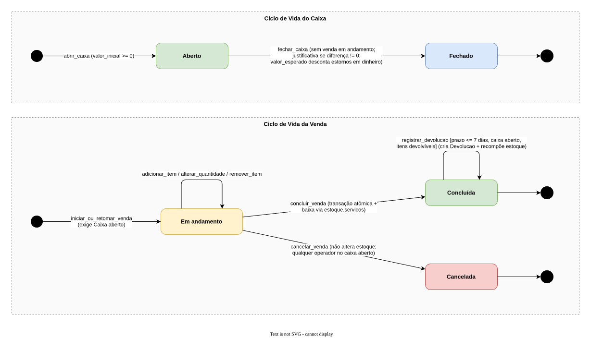
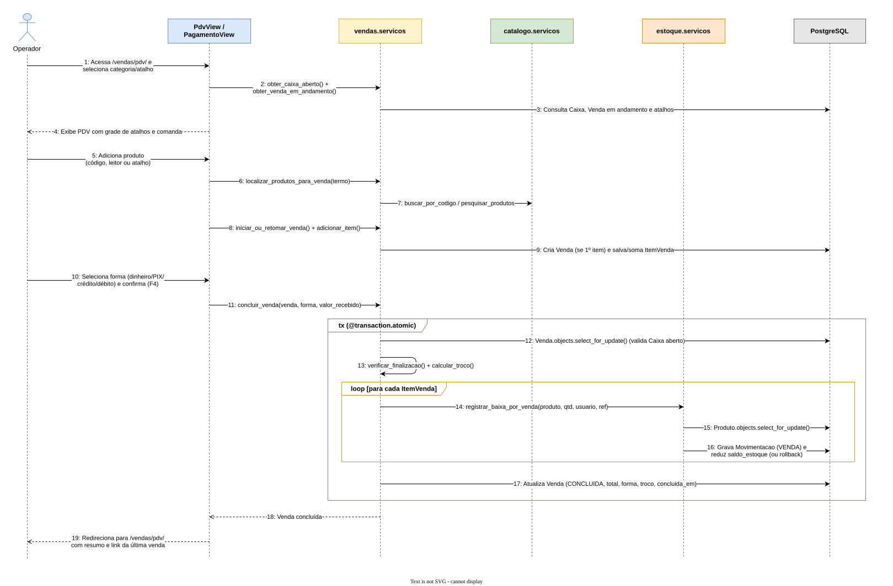
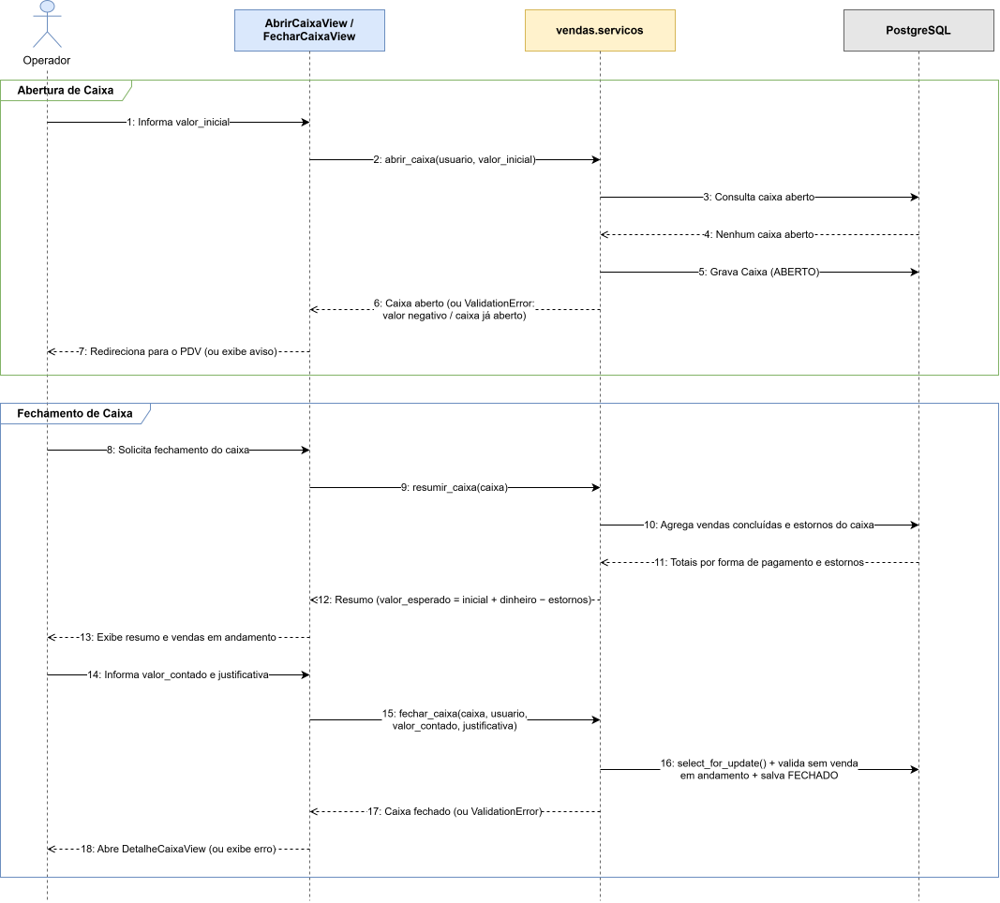
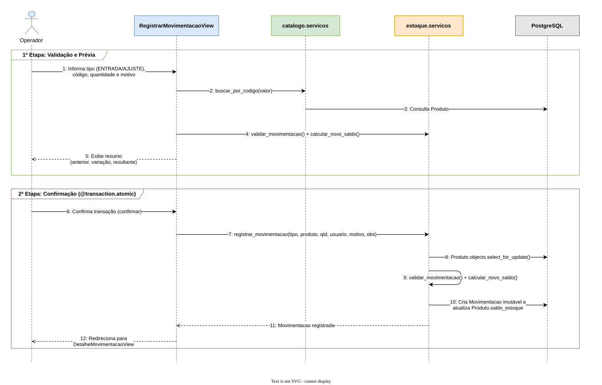
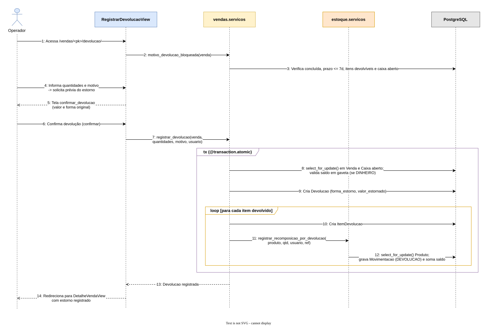

# Fluxos de Negócio e Máquinas de Estado

Este documento detalha os principais fluxos operacionais implementados na camada de serviços (`vendas/servicos.py`, `estoque/servicos.py` e `catalogo/servicos.py`) e no controle de turno (`contas/turno.py`).

---

## 1. Máquinas de Estado: Caixa e Venda

- **Caixa:** apenas um caixa pode permanecer `aberto` por vez (restrição `apenas_um_caixa_aberto`, validada em `abrir_caixa`). O fechamento exige que não haja nenhuma venda `em andamento` naquele caixa e contabiliza vendas em dinheiro e estornos em dinheiro no cálculo de `valor_esperado`.
- **Venda:** enquanto está `em andamento`, permite incluir, alterar quantidade ou remover itens; ao concluir, baixa o estoque atomicamente via `estoque.servicos`; ao cancelar (por quem iniciou ou por outro operador quando precisar liberar o fechamento do caixa), não altera o estoque. Uma venda `concluida` pode receber devoluções (parciais ou totais) dentro de `PRAZO_DEVOLUCAO_DIAS` (7 dias) enquanto houver um caixa aberto.

*(Arquivo fonte editável: [diagrama_estados.drawio](diagramas/diagrama_estados.drawio))*

---

## 2. Fluxo de Venda no PDV e Pagamento Atômico (RNF01)

A busca de produtos no PDV utiliza `catalogo.servicos` (`buscar_por_codigo` e `pesquisar_produtos`). O pagamento é selecionado diretamente na tela do PDV (`dinheiro`, `PIX`, `crédito` ou `débito`) e submetido para `PagamentoView` (`/vendas/pdv/<pk>/pagamento/`), que executa `vendas.servicos.concluir_venda` dentro de `@transaction.atomic` com bloqueio pessimista (`select_for_update()`), delegando a baixa de cada item a `estoque.servicos.registrar_baixa_por_venda` (que registra `Movimentacao` e reduz `Produto.saldo_estoque`). Se qualquer etapa falhar (ex.: falta de saldo), toda a transação sofre rollback.

*(Arquivo fonte editável: [sequencia_venda_pdv.drawio](diagramas/sequencia_venda_pdv.drawio))*

---

## 3. Fluxo de Abertura e Fechamento de Caixa

Na abertura, o operador informa o troco inicial em dinheiro (`valor_inicial`). No fechamento, `resumir_caixa` consolida as vendas concluídas por forma de pagamento, soma os estornos de devoluções realizadas nesse caixa e calcula o `valor_esperado` em dinheiro (`valor_inicial + recebido_em_dinheiro - estornos_em_dinheiro`). Se o `valor_contado` divergir do esperado, uma `justificativa` é obrigatória.

*(Arquivo fonte editável: [sequencia_caixa.drawio](diagramas/sequencia_caixa.drawio))*

---

## 4. Fluxo de Transação de Estoque (`UC10`)

Entradas de reposição e ajustes de contagem passam por duas etapas em `RegistrarMovimentacaoView`: primeiro o operador informa tipo (`ENTRADA` ou `AJUSTE`), produto (código interno ou código de barras), quantidade e motivo (obrigatório em ajustes), visualizando uma tela de confirmação com saldo anterior, variação e saldo resultante; ao confirmar, `estoque.servicos.registrar_movimentacao` bloqueia o `Produto` com `select_for_update()`, grava um registro imutável de `Movimentacao` e atualiza `Produto.saldo_estoque` na mesma transação.

*(Arquivo fonte editável: [sequencia_estoque.drawio](diagramas/sequencia_estoque.drawio))*

---

## 5. Fluxo de Devolução e Estorno (`UC16`)

Uma venda concluída dentro de 7 dias (`PRAZO_DEVOLUCAO_DIAS`) e com itens ainda devolvíveis pode ser devolvida parcial ou totalmente enquanto houver um caixa aberto. Em `RegistrarDevolucaoView`, o operador informa as quantidades e o motivo, confere o resumo do estorno (pelo preço praticado na venda e pela mesma forma de pagamento) e confirma. Dentro de `@transaction.atomic`, `vendas.servicos.registrar_devolucao` bloqueia `Venda` e `Caixa`, verifica o saldo disponível em gaveta (para estornos em dinheiro), cria `Devolucao` e `ItemDevolucao`, e aciona `estoque.servicos.registrar_recomposicao_por_devolucao` para recompor `saldo_estoque` e gravar `Movimentacao (DEVOLUCAO)`.

*(Arquivo fonte editável: [sequencia_devolucao.drawio](diagramas/sequencia_devolucao.drawio))*

---

## 6. Sessão por Turno de Atendimento

Para evitar que vendas fiquem registradas na conta de outro operador na troca de plantão, `contas/turno.py` (`TurnoMiddleware`) registra o instante do login na sessão (`inicio_turno`) e encerra a autenticação após `DURACAO_TURNO_MINUTOS` (padrão: `100` minutos, configurável via `.env`). Além disso, `SESSION_EXPIRE_AT_BROWSER_CLOSE = True` garante o encerramento automático ao fechar o navegador.
