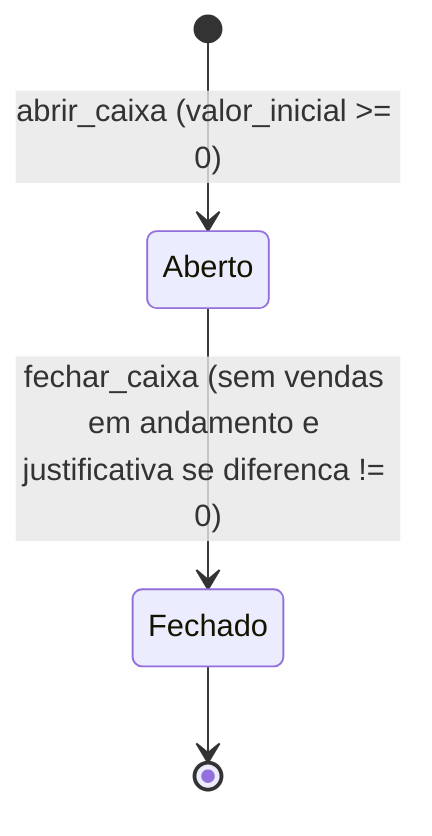
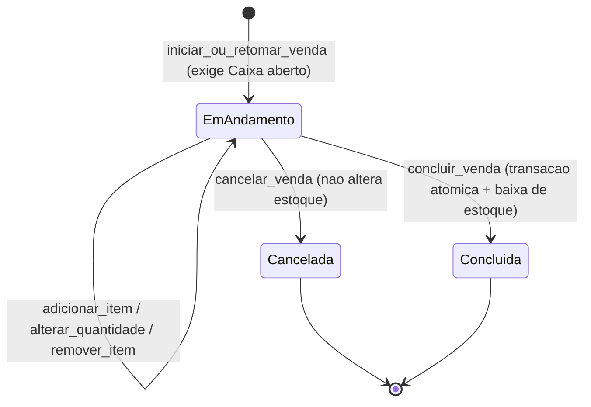
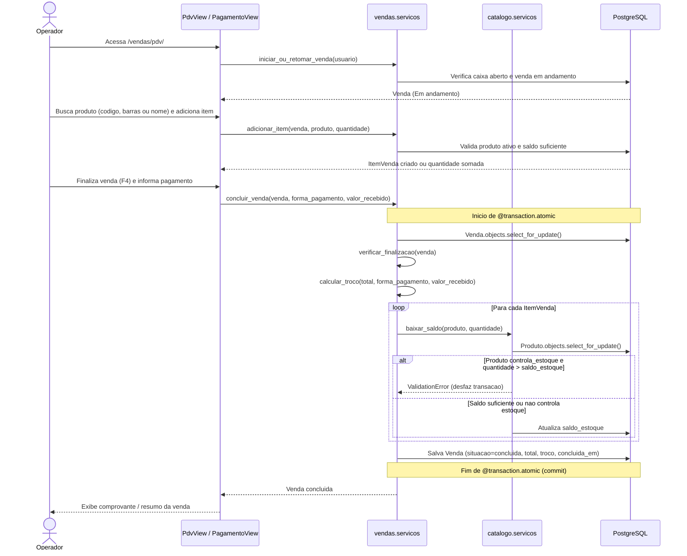
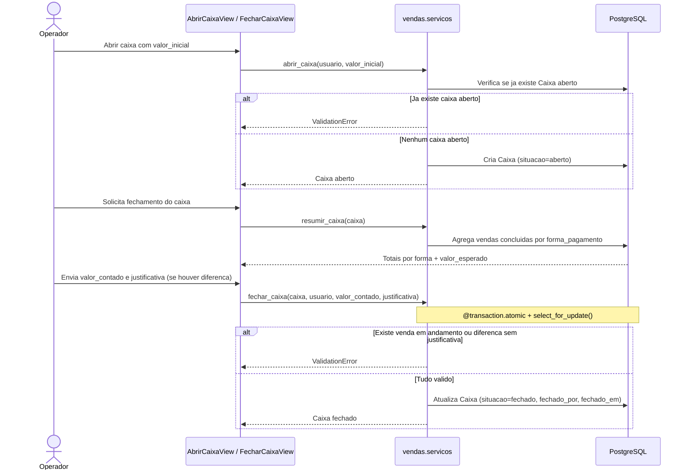

# Fluxos de Negócio e Máquinas de Estado

Este documento detalha os principais fluxos operacionais implementados na camada de serviços (`vendas/servicos.py` e `catalogo/servicos.py`).

---

## 1. Máquinas de Estado: Caixa e Venda

### Ciclo de Vida do `Caixa`

Apenas um caixa pode permanecer `aberto` por vez (garantido pela constraint `apenas_um_caixa_aberto` e verificado em `abrir_caixa`). O fechamento exige que não haja nenhuma venda `em andamento` naquele caixa.

### Ciclo de Vida da `Venda`

---

## 2. Fluxo de Venda no PDV e Pagamento Atômico (RNF01)

Ao concluir uma venda, o sistema executa `vendas.servicos.concluir_venda` dentro de `@transaction.atomic` com bloqueio pessimista (`select_for_update()`), garantindo que pagamento e baixa de estoque ocorram juntos ou sejam totalmente revertidos em caso de erro (como falta de saldo).

---

## 3. Fluxo de Abertura e Fechamento de Caixa

Na abertura, o operador informa o troco inicial em dinheiro (`valor_inicial`). No fechamento, `resumir_caixa` consolida as vendas concluídas por forma de pagamento e calcula o `valor_esperado` em dinheiro (`valor_inicial + recebido_em_dinheiro`). Se o `valor_contado` divergir do esperado, uma `justificativa` é obrigatória.

